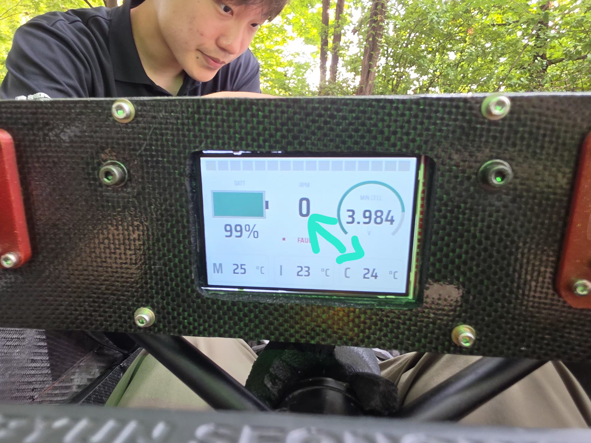
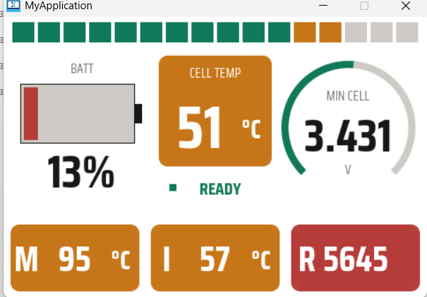
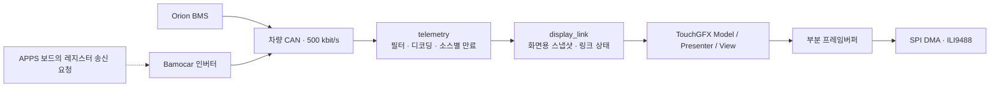

# LIGHT-ON DISPLAY

### 차량 CAN 데이터를 운전자가 읽을 수 있는 계기판으로

Orion BMS와 Bamocar 인버터의 CAN 데이터를 수신해 **STM32L432KC · ILI9488 · TouchGFX**로 표시하는 차량 계기판입니다. 배터리 잔량, 최소 셀 전압, 모터 회전수와 주요 온도를 한 화면에 배치하고, 값의 유효성과 통신 상태를 함께 관리합니다.

  

*차량 장착 사진. 촬영 당시의 화면 구성·상태이며 현재 소스의 UI 및 정상 동작 판정과는 구분합니다.*

`C / C++` · `STM32L432KC` · `CAN 500 kbit/s` · `TouchGFX` · `SPI DMA` · `480 × 320`

## 화면 구성

  

*첨부된 데스크톱 시뮬레이터 화면. 시뮬레이터는 합성 입력을 사용하므로 표시값은 차량 실측 데이터가 아닙니다.*

| 표시 요소 | 목적 |
| --- | --- |
| 배터리 잔량 | SOC를 숫자와 배터리 형태로 표현 |
| 최소 셀 전압 | 전압 숫자와 원형 게이지로 표시 |
| 셀·모터·IGBT 온도 | 임계값에 따라 타일 색상을 변경 |
| RPM·상단 시프트 바 | 회전수와 구간별 상태를 함께 표현 |
| 상태 배지·자리표시자 | 연결·인버터 fault·신호 유효성에 따라 표시 변경 |

밝은 배경, 큰 숫자, 경고 시 타일 전체의 색상 변화를 사용합니다. 경고 임계값은 [Screen1View.cpp](TouchGFX/gui/src/screen1_screen/Screen1View.cpp)의 현재 설정이며 차량 부품의 보장 한계나 인증값을 뜻하지 않습니다.

## 데이터 흐름

현재 계기판은 **차량 CAN에 직접 연결**됩니다. APPS 보드에서 UART 패킷을 받아 표시하던 이전 구성과 다릅니다. 계기판은 Bamocar 레지스터 요청을 직접 보내지 않으므로 인버터 응답을 받으려면 APPS 등 다른 노드에서 주기 송신을 요청해야 합니다.

## 핵심 설계

### 1. 수신·해석·표시를 분리

`telemetry`는 CAN ID와 레지스터별 payload를 해석하고, `display_link`는 디코딩 결과를 화면용 스냅샷으로 변환합니다. TouchGFX Model은 스냅샷과 유효성 정보를 읽어 View에 전달합니다. 화면 레이아웃을 바꾸는 작업과 CAN 해석을 바꾸는 작업이 서로 다른 파일에서 이루어집니다.

주요 수신 ID는 Orion 요약 `0x446`, 팩 정보 `0x447`, 선택적 셀 브로드캐스트 `0x036`, Bamocar 응답 `0x181`입니다. Bamocar `0xA8`은 필터된 회전수이며 실제 토크 레지스터와 구분합니다.

### 2. 부분 프레임버퍼와 비동기 SPI 전송

480 × 320 RGB565 전체 프레임버퍼 하나는 307,200바이트가 필요합니다. 현재 TouchGFX의 `ManyBlockAllocator<4800, 3, 2>`는 **4800바이트 블록 3개, 총 14,400바이트의 부분 프레임버퍼**를 사용합니다. 마지막 인자 `2`는 픽셀당 바이트 수입니다. 이는 픽셀 버퍼 용량만의 비교이며 관리 구조체·전송 버퍼를 포함한 전체 RAM 사용량은 별도입니다.

ILI9488 전송은 픽셀당 3바이트 형식으로 처리합니다. DMA로 블록 전송을 시작하고, 완료 콜백을 TouchGFX에 연결해 다음 블록 그리기와 전송을 겹칠 수 있도록 구성했습니다. 그리기·전송 시간을 관찰하기 위한 DWT 사이클 카운터도 있습니다. FPS나 개선 배율은 실측 자료 없이 제시하지 않습니다.

### 3. 통신 연결과 데이터 유효성을 따로 관리

- 수신 프레임이 300 ms 동안 없으면 링크 연결을 해제합니다.
- 화면용 telemetry freshness는 1000 ms 기준으로 관리합니다.
- 디코더는 소스별 1000 ms 만료 처리를 하며, 최소 셀 전압에는 별도 3000 ms 만료 처리도 있습니다.
- View는 freshness와 `valid_mask`를 사용해 사용할 수 없는 값을 자리표시자로 바꿉니다.

만료 처리는 현재 소스 그룹 단위입니다. Bamocar의 모든 레지스터에 개별 타임아웃이 있는 구조로 해석하면 안 됩니다. 화면의 `READY` 역시 링크·매핑된 상태를 바탕으로 한 표시이며 **APPS 안전 판정 전체나 차량 구동 허가를 보증하지 않습니다.**

### 4. 값이 바뀐 영역만 갱신

Model은 패킷 카운터·연결·freshness 변화를 확인해 화면 갱신을 전달합니다. 최소 셀 전압 링은 10 mV 간격으로 양자화해 작은 입력 변화에 따른 재그리기를 줄입니다. 숫자 표시와 게이지 갱신 기준을 분리하고, 상태 배지는 fault 변경 시 갱신하도록 구성했습니다.

### 5. 통신과 표시 문제를 구분할 수 있는 진단 경로

메인 루프는 CAN 상태 갱신과 수신 처리를 화면 처리보다 먼저 실행합니다. CLI에서는 링크 상태, 소스별 수신, 디코딩된 신호를 확인할 수 있습니다. 패널 리셋 뒤 전체 재그리기를 요청하는 경로도 두어, 패널 초기화와 화면 갱신을 구분해 점검할 수 있습니다.

## 코드 구성

| 경로 | 역할 |
| --- | --- |
| [ap.c](src/ap/ap.c) | CAN 갱신 → 수신 처리 → TouchGFX → CLI 실행 순서 |
| [telemetry.c](src/ap/telemetry/telemetry.c) | Orion·Bamocar 디코딩, 소스별 진단·만료 |
| [display_link.c](src/ap/display_link.c) | 신호 매핑, 링크·화면용 스냅샷 |
| [Model.cpp](TouchGFX/gui/src/model/Model.cpp) | 실차 스냅샷과 시뮬레이터 합성 입력 분기 |
| [Screen1View.cpp](TouchGFX/gui/src/screen1_screen/Screen1View.cpp) | 화면 배치·경고색·게이지·값 표시 |
| [TouchGFXHAL.cpp](TouchGFX/target/TouchGFXHAL.cpp) | DMA 완료 연결·전송 상태·성능 계측 |
| [ili9488.c](src/hw/driver/lcd/ili9488.c) | LCD 패널 명령과 픽셀 전송 |

## 빌드와 실행

### MCU 펌웨어

1. STM32CubeIDE에서 저장소 최상위 `.project` / `.cproject`를 기존 프로젝트로 가져옵니다.
2. 프로젝트 타깃은 STM32L432KCUx입니다. CAN 트랜시버와 ILI9488 배선을 실제 보드 기준으로 확인합니다.
3. [hw_def.h](src/hw/hw_def.h)의 `HW_USE_TOUCHGFX_DEMO`를 확인합니다. 기본값 `0`은 실제 CAN 입력, `1`은 보드 내부 합성 입력입니다.
4. 빌드 산출물을 ST-Link/SWD로 기록합니다.
5. CLI는 USART2 `PA2 / PA15`, `57600 baud / 8-N-1`입니다. `display info`, `telemetry info`, `telemetry signal`로 수신 상태를 점검합니다.

### 데스크톱 시뮬레이터

TouchGFX 4.26.1 설치와 해당 버전의 호스트 빌드 도구·라이브러리가 필요합니다. 현재 Makefile의 설치 경로 의존성과 빌드 명령은 [프리뷰 안내](TouchGFX/PREVIEW.md)를 참고합니다. 저장소에 없는 PowerShell 빌드 스크립트는 실행 방법으로 사용하지 않습니다.

## 확인할 범위

첨부 사진은 실물 장착과 화면 형태를 보여줍니다. 사진만으로 CAN 해석 정확도나 지연·FPS를 검증한 것으로 간주하지 않습니다. RPM은 Bamocar NMAX 수신 전 기본 환산값 `6500`을 사용하므로 드라이브 설정과 대조해야 합니다. 경고 온도, CAN 단절 시 표시, 실제 SPI 처리 성능 역시 하드웨어 검증 대상입니다.

실물 사진과 시뮬레이터 캡처의 UI는 서로 다른 시점일 수 있습니다. 현재 동작의 기준은 소스와 빌드 설정입니다.

## 관련 자료

- [TouchGFX 프리뷰 안내](TouchGFX/PREVIEW.md)
- [계기판 핀맵 이미지](민석님%20lcd%20핀맵.png)
- [개편 전 README 원본](README.before-portfolio-2026-11-14.md)

STM32 HAL·TouchGFX 프레임워크와 생성 코드는 기반 구성으로 사용합니다. 이 저장소의 설명은 차량 신호 해석, 화면 연결, LCD 전송과 UI 구현에 초점을 둡니다.
